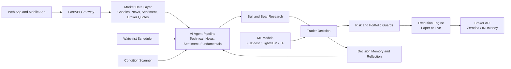

<p align="center">
  
</p>

<p align="center">
  Full-stack AI and ML trading platform for Indian markets, with web and mobile apps, broker integration, live data, scanners, strategy workflows, and portfolio intelligence.
</p>

<p align="center">
  
  
  
  
  
  
</p>

<p align="center">
  <a href="docs/README.md">Documentation</a> •
  <a href="docs/QUICK_START.md">Quick Start</a> •
  <a href="docs/API.md">API</a> •
  <a href="docs/SECURITY.md">Security</a>
</p>

## Why FastTrade

FastTrade is a unified platform for analysis, execution, risk control, and post-trade learning built specifically for Indian markets.

- Multi-agent AI analysis pipeline with technical, sentiment, news, fundamentals, bull and bear research
- Real-time monitoring through WebSocket streams
- Automated watchlist workflows with pre-market analysis and suggestions
- Web dashboard (React 18 + Vite) plus React Native mobile app (Expo 54)
- Broker connectivity for Zerodha and INDMoney with live and paper execution
- Built-in decision memory and outcome reflection loop
- ML models (XGBoost, LightGBM, TensorFlow, scikit-learn) for signal generation

## Core Capabilities

### Trading Intelligence

- AI analysis pipeline with structured reports and final decision output (`/ai_analysis`, `/ai_chat`, `/simple_ai`)
- Multi-agent quant bots and scalp trading engine
- Condition-based scanner with strategy discovery and decay scheduling
- Swing scanner and screener with timeframe suggestions
- Decision history with outcome evaluation and reflections
- Watchlist prioritization with pre-market analysis scheduler
- Strategy marketplace for sharing and importing strategies

### Risk and Execution

- Confirmation-gated live trade flows with safety guardrails
- Paper trading with real-time MTM updates via WebSocket
- Auto-exit on expiry and scheduled auto-exit rules
- Position and portfolio overview with broker reconciliation
- Trade cost tracker and strategy P&L analytics
- FII/DII data integration and peer comparison

### Market Data and Analytics

- Candle data backfill and intraday candle scheduler
- Options chain with real-time Greeks (Delta, Gamma, Theta, Vega)
- Option spread strategies with payoff analysis
- Market depth (Level 2), VIX tracking, economic calendar
- Twitter/X sentiment and RSS news feeds
- FII/DII flow data and fundamentals cache

### Product Surfaces

- Web app: 37 pages covering dashboard, strategies, ML center, backtest, options, scanners, terminal, and more
- Mobile app: 26 screens including AI agents, scanner execution, strategy builder, and SMS scanner
- API-first backend with FastAPI interactive docs at `/docs`
- Alexa skill integration for voice-driven queries

## Architecture

- Backend: FastAPI 0.110 + SQLAlchemy 2.0 + APScheduler 3.10
- Data: PostgreSQL 16 (via Docker) + SQLite (local dev)
- Web: React 18 + TypeScript + Vite 5 + Tailwind CSS 3
- Mobile: React Native 0.81 + Expo 54 + Expo Router
- ML: scikit-learn, XGBoost, LightGBM, TensorFlow, SHAP, Optuna
- Integrations: Zerodha (kiteconnect), INDMoney, NewsData API, Twitter/X (tweepy), RSS feeds

High-level flow:

```
Web and Mobile clients → FastAPI Gateway → Database + Schedulers + External Market Providers
```

## Important Flow Diagram



## Repository Layout

```
backend/          FastAPI app, routes, services, schedulers, ML models, tests
  app/
    api/routes/   60+ route modules (auth, strategies, ml, options, scanner, …)
    core/         Auth, broker clients, market scheduler, auto-trader engine
    db/           SQLAlchemy models and session management
    services/     Trading agents, WebSocket, health monitor
  models/         Trained ML model files (.joblib / .json)
  scripts/        Backfill, repair, snapshot, strategy lab utilities
  tests/          Unit and integration tests
web/              React 18 web client (37 pages)
mobile/           React Native / Expo 54 mobile client (26 screens)
docs/             Setup guides, API docs, architecture, security, changelogs
redmes/           Internal analysis docs and implementation roadmap
```

## Web Pages

Dashboard, Strategies, Strategy Builder, Strategy Marketplace, Strategy P&L, Backtest, Backtest Comparison, Scanner (Create + Execution), Screener, ML Center, ML Intelligence, Quant Bot, Scalp Trading, Options Chain, AI Analysis, AI Assistant, Auto Trader, Positions, Journal, Finance Tracker, Trade Cost Tracker, Heatmap, FII/DII, Stock Research, Multi-Timeframe, Broker Reconciliation, Signal Reconciliation, Candle Backfill, Scheduled Jobs, Calendar, Terminal, Bloomberg Terminal, Draggable Dashboard, Settings, Login.

## Mobile Screens

Dashboard, Watchlists, Scanner, Scanner Execution, Strategies, Strategy Builder, Strategy P&L, Positions, Options Chain, AI, AI Agents, Backtest, Auto Trader, ML Center, Finance, Heatmap, News, Journal, Calendar, Broker Reconciliation, Trade Cost Tracker, SMS Scanner, Account, Settings.

## Quick Start

### Option 1: Docker Compose

1. Configure backend environment:
   ```
   cp backend/.env.example backend/.env
   # Edit backend/.env with your API keys
   ```
2. Start all services:
   ```
   docker compose up --build
   ```
3. Open:
   - Web: http://localhost:3000
   - API docs: http://localhost:8000/docs

### Option 2: Local Development

**Backend**
```bash
cd backend
python -m venv venv
# Windows: venv\Scripts\activate  |  macOS/Linux: source venv/bin/activate
pip install -r requirements.txt
uvicorn app.main:app --reload --port 8000
```

**Web**
```bash
cd web
npm install
npm run dev        # http://localhost:5173
```

**Mobile**
```bash
cd mobile
npm install
npx expo start
```

You can also use the setup scripts at the project root:
- `setup.bat` (Windows)
- `setup.sh` (macOS/Linux)

## Configuration

See detailed setup guides in docs:

- `docs/SELF_HOST_SETUP.md`
- `docs/QUICK_START.md`
- `docs/ZERODHA_SETUP_GUIDE.md`
- `docs/AUTHENTICATION_DEPLOYMENT_GUIDE.md`
- `docs/BACKTEST_DATA_SOURCES_GUIDE.md`
- `docs/ML_CENTER_USER_GUIDE.md`

Key environment variables (backend/.env):

| Variable | Description |
|---|---|
| `DATABASE_URL` | PostgreSQL connection string |
| `ZERODHA_API_KEY` | Zerodha kiteconnect API key |
| `NEWSDATA_API_KEY` | NewsData.io API key for news feed |
| `JWT_SECRET` | Secret for JWT auth tokens |
| `SCHEDULERS_ENABLED` | Set `false` to disable background schedulers |
| `CORS_ALLOWED_ORIGINS` | Comma-separated extra allowed origins |

Recommended first-run safety:

- Start in paper-trading mode
- Enable authentication and set a strong `JWT_SECRET`
- Configure conservative risk limits before live execution

## ML Models

Pre-trained models are included in `backend/models/`:

- `ensemble_model.joblib` — Ensemble classifier for signal generation
- `stock_daily_model.joblib` — Daily stock prediction model

The ML stack includes scikit-learn, XGBoost, LightGBM, TensorFlow, SHAP (explainability), and Optuna (hyperparameter tuning). Retrain via the ML Center page or `backend/scripts/`.

## Testing

**Backend**
```bash
cd backend
pytest tests/
```

**Web (Playwright E2E)**
```bash
cd web
npm test
```

Test coverage includes: AI chat, Alexa integration, broker protection, condition scanner, option signals, paper margin, quant bots, scanner sprint features, and watchlist quotes.

## Documentation

Start here: `docs/README.md`

Useful references:

- `docs/API.md`
- `docs/FUNCTIONAL_SPEC.md`
- `docs/SYSTEM_ARCHITECTURE_DIAGRAM.md`
- `docs/SECURITY.md`
- `docs/CHANGELOG.md`
- `docs/THREAT_MODEL.md`
- `docs/DEPLOYMENT_CHECKLIST.md`
- `docs/GREEKS_API_IMPLEMENTATION.md`
- `docs/IV_RANK_SETUP.md`
- `docs/SPREAD_DETECTION_GUIDE.md`
- `docs/NVIDIA_AI_CHAT.md`
- `docs/ALEXA_NVIDIA_SETUP.md`

## Contributing

Contributions are welcome.

1. Create a feature branch
2. Keep changes scoped and tested
3. Open a pull request with a clear description

## Disclaimer

This project is for research and educational use. It is not financial advice. Trading involves risk, including possible loss of capital. Always test in paper-trading mode before enabling live execution.
